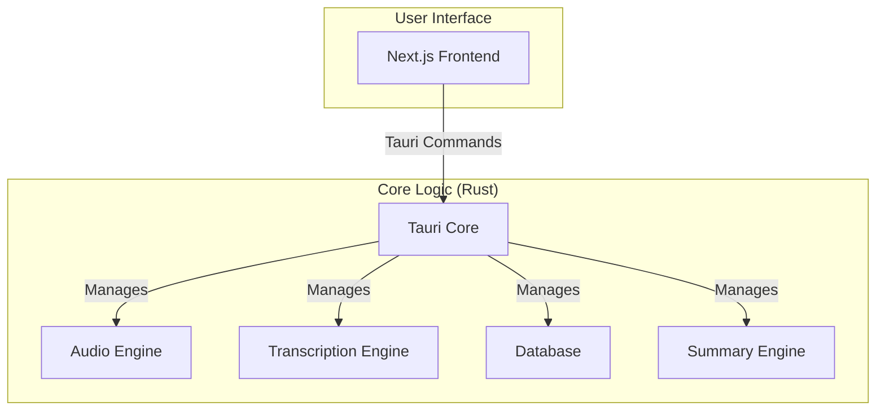

# Meetily tech stack and architecture

Reference notes on [Zackriya-Solutions/meetily](https://github.com/Zackriya-Solutions/meetily) (30k+ stars, MIT, actively maintained — pushed same-day as of this writing), captured while evaluating open-source projects adjacent to this one. Not adopted directly — the stack is Rust/Python/Tauri, totally different from this project's Node/TS + Chrome extension — but kept here because it's the most battle-tested open-source project in this exact problem space, worth returning to for pipeline-design ideas. Findings below are from reading the repo's own `docs/architecture.md`, `README.md`, and source files directly (file tree, `Cargo.toml`, `backend/app/main.py`, `backend/app/transcript_processor.py`), not secondhand descriptions.

## 1. What it is

A privacy-first, self-hosted desktop meeting assistant: records system + microphone audio locally, transcribes with a local Whisper/Parakeet model, diarizes speakers, and summarizes via a choice of LLM backends (local Ollama or cloud APIs with your own key). Positioned explicitly against Otter.ai/Fireflies/Granola on the "your audio never leaves your device" axis. Ships as installers for macOS and Windows (Linux via build-from-source).

## 2. Tech stack

| Layer | Technology |
|---|---|
| UI shell | [Tauri](https://tauri.app/) (Rust) wrapping a Next.js frontend |
| Frontend | Next.js, TypeScript |
| App core | Rust |
| Audio capture | [`cpal`](https://github.com/RustAudio/cpal) (cross-platform Rust audio I/O) |
| Local transcription | [`whisper-rs`](https://github.com/tazz4843/whisper-rs) (Rust bindings to whisper.cpp), optional Parakeet | GPU accel via feature flags: Metal/CoreML (macOS), CUDA/Vulkan (Windows/Linux), OpenBLAS/OpenMP (CPU) |
| Backend service | Python, FastAPI + uvicorn |
| Summarization orchestration | [`pydantic-ai`](https://ai.pydantic.dev/) `Agent`, targeting Ollama (local), Anthropic, Groq, or OpenAI |
| Local storage | **Two separate SQLite databases** — see §5 |
| Packaging | Docker (`Dockerfile.app`, `Dockerfile.server-cpu`, `Dockerfile.server-gpu`, `Dockerfile.server-macos`) alongside the native installers |

## 3. Component architecture

The repo's own `docs/architecture.md` diagram:



**This diagram undersells the actual system.** Reading the source: "Summary Engine" is not Rust — it's a separate Python FastAPI process (`backend/app/main.py`, `transcript_processor.py`) that the Rust core talks to over local HTTP (FastAPI with `CORSMiddleware(allow_origins=["*"])`, i.e. wide-open CORS — worth noting since this project's own server deliberately restricts to `ALLOWED_EXTENSION_ID`; Meetily doesn't lock this down even though it's also a local-only service). So the real shape is:

- **Next.js frontend** — rendered inside the Tauri webview, talks to the Rust core via Tauri's `invoke` command bridge (not HTTP).
- **Rust/Tauri core** — owns audio capture (`cpal`) and local transcription (`whisper-rs`), runs in-process inside the desktop app.
- **Python FastAPI sidecar** — a separate local HTTP server (REST API below) that owns meeting persistence, transcript search, and LLM-based summarization. Spawned alongside the Tauri app, not compiled into it.

This two-process-over-localhost split is architecturally similar in spirit to this project's own extension-talks-to-a-local-Node-server design — just with a Rust GUI shell in front instead of a Chrome extension, and Python instead of Node on the backend.

## 4. Audio capture

`cpal` handles both microphone and system-audio capture, with platform-specific modules for each (`audio/capture/{system,microphone,core_audio}.rs`, `audio/devices/platform/{macos,linux}.rs`). Unlike this project's tab-capture-only approach (Chrome's `chrome.tabCapture`, audio only from within the browser tab), Meetily captures true system-level loopback audio — meaning it can pick up sound from any application, not just a browser tab, at the cost of needing OS-level permissions (macOS screen-recording permission is required for system audio capture, per `BLUETOOTH_PLAYBACK_NOTICE.md` and `check_screen_permission.swift` in the tree).

## 5. Transcription and diarization

Runs **entirely local and offline** via `whisper-rs` (whisper.cpp bindings), with GPU acceleration auto-selected per platform. A separate `backend/whisper-custom/server/` (a C++ `httplib`-based whisper.cpp HTTP server, built via `download-ggml-model.sh`) appears to serve the same role for the Docker deployment path, as an alternative to the embedded `whisper-rs` used in the native desktop build — the repo has two parallel transcription code paths depending on how you run it, not one unified engine.

One inconsistency worth flagging before relying on this: the current README's PRO-tier callout says *"Speaker diarization is also planned for PRO in mid-June"*, while the repo description and other docs describe diarization as already present in the free/community build. Don't assume full diarization is available in the OSS edition without checking the current release notes — this may be a stale README fragment, or diarization may be partially gated.

## 6. Summarization pipeline

The interesting part for comparison against this project's `reporting.ts`:

- **Structured, schema-constrained output.** `transcript_processor.py` defines a Pydantic `SummaryResponse` model and passes its JSON schema to the LLM — via `pydantic-ai`'s typed `Agent` for cloud providers, and via Ollama's native `format=<json_schema>` parameter for local models. This guarantees the model's response matches the shape, rather than hoping a prompt instruction is followed. **This is the pattern already adopted into this project's `reporting.ts`** (OpenAI `response_format: {type: 'json_schema', strict: true}` for `summarize`/`reconcileSpeakers`), so no further action needed here — noted for context on where the idea came from.
- **Chunking with overlap, but no merge step.** Long transcripts are split into overlapping chunks (`chunk_size - overlap` sliding window; smaller chunks for weaker local models like Phi4/Llama, larger for stronger ones). Each chunk is summarized independently and appended to a list (`all_json_data`) — **there is no reduce/merge pass** that combines chunk summaries into one coherent report. Each chunk's summary just becomes its own section in the UI. If this project ever needs chunking for very long meetings, don't copy this part — it's a real limitation, not a pattern worth reusing.

## 7. Data storage

Two independent SQLite databases, not one:

- **Rust side** (`frontend/src-tauri`, via `sqlx`): app-local state — licensing, analytics, settings, migrations tracked under `frontend/src-tauri/migrations/` (e.g. `add_speaker_field`, `add_meeting_notes`, `add_ollama_endpoint`).
- **Python side** (`backend/app/db.py`, via `DatabaseManager`): meetings, transcripts, summaries, API keys.

No indication the two are kept in sync beyond whatever the Rust core forwards to the Python API at write time — worth treating as two sources of truth rather than one, if ever digging deeper into this codebase.

## 8. API surface (Python backend)

```
GET  /get-meetings
GET  /get-meeting/{meeting_id}
POST /save-meeting-title
POST /delete-meeting
POST /process-transcript
GET  /get-summary/{meeting_id}
POST /save-transcript
GET  /get-model-config
POST /save-model-config
GET  /get-transcript-config
POST /save-transcript-config
POST /get-api-key
POST /get-transcript-api-key
POST /save-meeting-summary
POST /search-transcripts
```

## 9. Why this is worth keeping around

Not for code reuse (different language, different runtime model) but as a reference for:

- **Pipeline sequencing** — capture → local ASR → diarization → schema-constrained LLM summarization → persistence, as a proven end-to-end shape with 30k+ stars of real-world usage behind it.
- **A local-first alternative path**, if this project ever needs an offline mode that doesn't depend on the OpenAI API (e.g. for privacy-sensitive meetings) — `whisper-rs`/whisper.cpp + Ollama is the natural pairing to look at first, and Meetily is a working example of wiring both together with GPU acceleration handled per-platform.
- **What not to do**: wide-open CORS on a local service, two independently-evolving databases with no visible sync contract, and per-chunk summaries with no final merge. All three are places this project's existing design already does better.

## Sources

- [Zackriya-Solutions/meetily](https://github.com/Zackriya-Solutions/meetily) — repo root, file tree
- [docs/architecture.md](https://github.com/Zackriya-Solutions/meetily/blob/main/docs/architecture.md)
- [README.md](https://github.com/Zackriya-Solutions/meetily/blob/main/README.md)
- [backend/app/main.py](https://github.com/Zackriya-Solutions/meetily/blob/main/backend/app/main.py)
- [backend/app/transcript_processor.py](https://github.com/Zackriya-Solutions/meetily/blob/main/backend/app/transcript_processor.py)
- [frontend/src-tauri/Cargo.toml](https://github.com/Zackriya-Solutions/meetily/blob/main/frontend/src-tauri/Cargo.toml)
